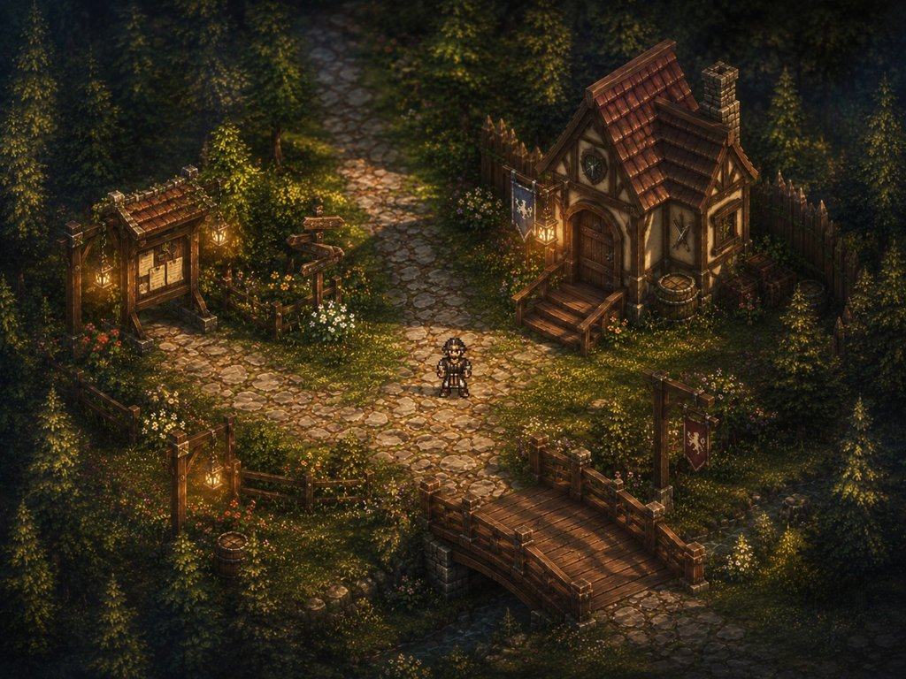

# Style guide

The art direction of the Diorama RPG ([plan](DioramaRPG.md)), the engine's first full test project. It says what the game should look like, the rules every new asset follows, and how assets are made today, so that the art keeps moving towards one look while the engine grows (2D sprites now, depth, meshes and post-processing later). The palette and constants in this page are code: `scripts/diorama_rpg/style.py`. When they change, change both.

Updated October 25, 2026 (V2 art direction). Read [Sprite sizes](SpriteSizes.md) before changing asset dimensions; [Scene review, Oct 25](SceneReview-2026-10-25.md) lists the prioritised fixes from the current build.

## The look in one paragraph

A small, hand-made world seen like a **miniature diorama**: pixel-art characters in front of richly textured, softly lit places. Late-afternoon and dusk light: **warm lantern and window light against cool green-blue shade**. Surfaces are worn and lived-in (cobbles with moss in the joints, mossy terracotta roofs, weathered plaster, ferns at the foot of trees). The edges of a scene fall into dark foliage, so the playable space reads as a lit stage. Illustrated/pixel-authored material textures use coherent few-step colour ramps and crisp intentional clusters, not arbitrary fine noise. **Lighting and compositing** may have smooth gradients; **sprite pixels** must remain crisp.

Reference points (for principles, not copying): the concept art in `docs/images/` (the project's own); *Octopath Traveler II* for layered 2D/3D environments, depth and atmosphere; *Final Fantasy Resonance* for taller expressive pixel characters, large locations and more dynamic cinematic staging. Use original designs and art, not traced game assets. Review screenshots of our own build are kept outside the repository; game screenshots are never stored here.

## Camera and scale

| Thing | Rule |
| --- | --- |
| World coordinate scale | **KEEP** 32 px per world unit for the current working 2D scenes (`PixelsPerUnit: 32`). Do not silently change the engine world scale to make sprites more detailed. Nearest filtering on pixel art; no mipmaps on sprites. |
| View: now | Top-down three-quarter **2D**, composed with foreground occluders, distinct near/mid/far planes, shadow pools and clear landmarks. Keep the player readable even when the ground is busy. |
| View: future | Upright sprites or cut-out cards with feet/base anchoring, actual depth, meshes for ground/buildings and camera tilt. Separate camera profiles for field, battle and cinematics. |
| Field heroes/NPCs - current | **32 x 56 px frame**, feet pivot `[0.5, 0]`; 1 x 1.75 world units at 32 PPU. Keep for the current playtest. Four facing directions: Down/Up/Left/Right; mirroring Right is allowed only if costume/accessories are symmetrical. |
| Field heroes/NPCs - optional V2 | **48 x 84 px at 48 PPU**, same 1 x 1.75 world-unit size, if/when making a deliberate fidelity migration. Do **not** mix this with 32 PPU per sprite by accident. All field assets must be evaluated in the same camera framing. |
| Battle heroes | **96 x 128 px sprite cells**, side view facing left, one animation per row, per-frame timing in the `.hyanim`. Done for Orin and Lila (`scripts/diorama_rpg/battle_sprites.py`); the character stands right of centre so the weapon has room in front, and the pivot is at the feet (Orin `[0.656, 0.031]`, Lila `[0.677, 0.031]`). Drawn at 16 px per battle unit (6 x 8 units). Poses in [Sprite sizes](SpriteSizes.md). |
| Enemies | Field icons/proxies follow the field grid. Battle Wisp 96 x 96; medium enemy 128 x 144; elite 192 x 192; boss up to 256 x 256 (all *art canvases*, not world-unit size). |
| Props | Size by real world units at 32 PPU now: barrel about 24 x 32; house 4 to 5 units wide; tree trunk anchored at its **base**, canopy may overhang. |
| Camera | Current village orthographic ~11 world units vertically; validate legibility at the target **game display resolution** and in motion. Battle viewport framing is independent of field PPU. |

## Quality target and what the screenshots tell us

We are **not yet** at the final diorama look. The statue plaza already has attractive stone variation, planters and a strong landmark, but the cobbles have very high local contrast and the characters feel visually lost. The current battle has a useful gameplay layout (turn strip, shields/weakness symbols, party HUD), but the flat elliptical arena, generic layered treeline and small stiff character sprites read as conventional 2D pixel art. Those are staging, hierarchy and sprite-design issues, not just missing bloom.

- **Preserve:** warm/cool palette, crisp pixel clusters, dark foreground framing, playable battle loop, current code-generation pipeline.
- **Improve now (2D renderer):** character silhouettes, higher-quality battle poses, less noisy path textures, battle backdrop with near/middle/far staging, shadow contact, interaction/target feedback, more intentional UI type hierarchy.
- **Improve later (3D renderer):** depth-aware alpha cut-outs, 3D set dressing, specular and volumetric accents, camera tilt and parallax, optional selective depth of field, soft shadows and cinematic camera movement.
- **Do not imitate** screenshots pixel-for-pixel. Aim for the *feeling*: authored detail + depth + theatrical light + legible combat.

See [Scene review, Oct 25](SceneReview-2026-10-25.md) for prioritised fixes, with checklists tied to both captures.

## Light

- The key light comes from the **upper left** (`style.LIGHT`). Every sprite is shaded for it: lit top-left edges, darker bottom-right, a darker band where a roof or canopy overhangs.
- **Dusk** is the default time of day. Day, dusk and night are presets of the global light (`VillageDirector`, keys 1 to 3); night is blue-teal, never black.
- Warm light sources (lanterns, windows, braziers, torches) are point lights in **lantern amber** `#F2A43A` and are placed where the art shows the source. Magic and spirits are cool: **magic blue** `#45C7E8`.
- Sprites are drawn to be lit: mid-value colours, so a warm light can brighten them and the night can darken them without losing the silhouette.
- Every standing thing has a blob shadow (`Shadow2DComponent`) at its feet.

## Palette

The ramps live in `scripts/diorama_rpg/style.py`; a material uses one ramp, never a single flat colour. The GDD's palette sheet is `docs/images/diorama_palette.jpg`.

| Ramp | Colours (dark to light) | Used for |
| --- | --- | --- |
| Grass | `#1b2a19 #26391f #334a26 #41592b #53692f #6b7d36 #8a923f` | ground, bushes |
| Moss | `#2b3d1e #3f5527 #5a7030 #7d8c3a` | cobble joints, roofs, stones |
| Dirt | `#3e2c1c #57402a #705336 #8A6740 #a07c4e #b6925a` | roads outside the village, arena, path rims |
| Cobble | `#38342d #4f493e #665e4f #7d7461 #9B9074 #b5a986` (joints `#3a342b`) | streets, plaza |
| Terracotta | `#3a160e #5A2417 #83391f #A44D27 #c2632f #D07A3C` | roofs, pots |
| Plaster / timber | `#8a7a62 ... #e2d2b0` / `#2a1a10 #3B2317 #5a3820 #7A421F` | timber-frame houses, carts, fences |
| Stone | `#3e3b36 #5a564e #7a756a #9a9384 #b9b19f` | foundations, walls, rocks |
| Foliage | `#132013 #1f3320 #2f4a2a #4a6a30 #76913a #b0b04a` | trees, ferns, leaves |
| Forest shade | `#101a12` | the map's edges, foreground leaves |
| Light | lantern `#F2A43A`, window glow `#c97a2a #f2a43a #ffd27a #fff0c0`, magic `#45C7E8` | light sources |
| UI | black glass `#15120c`, gold `#c99a3f`, parchment `#D9BE83`, text `#f3e3b8` | menus, battle UI |

## Pixel rules

1. **Binary alpha.** A pixel is opaque or empty; no soft edges, no semi-transparent fringe. Never trust a "transparent" image from an AI tool: check the alpha channel (a painted checkerboard is not transparency).
2. **Selective inner outline.** Characters and handheld props usually get a 1 px outline inside their silhouette, darkened from local palette (about 0.45x), not pure black. Do not outline every leaf, ground tile or cobblestone; group surfaces to avoid noisy interiors.
3. **Ramps, not per-pixel confetti.** Target 4 to 7 deliberate values per material, chosen with `style.step_ramp`; cluster details rather than independent random pixels. Dither sparingly (4 x 4 Bayer) only on large material planes, **never on faces as default**.
4. **Texture at the right scale.** Detail is 1 to 3 px: grass blades, stone joints, wood grain, roof shingles. Nothing finer than a pixel and no blurry upscales.
5. **Shading follows the light.** Upper-left lit, lower-right shaded; each stone, shingle and leaf clump has its own little highlight and shadow.
6. **No pure black / pure white in base art** except the hottest centre of a light or spark. Real-time HDR bloom is a separate effect and should not recolor the source sprites.
7. **Readability first.** Characters must separate from busy ground at native game view size: use coherent silhouette, value separation, contact shadow and controlled local contrast. Test without post-processing.

## Character art direction

**Orin Kenshi:** ~30-year-old, experienced two-handed-sword traveler, weathered dark cloth/leather, small practical steel pieces (one shoulder, bracers), rugged hair and a distinctive scarf; readable blade silhouette. Scars and age through posture/face rather than oversized armor. **Lila Stormtree:** attractive, warm, approachable white mage with ivory and muted blue clothing, travel boots, practical cape, simple gold ornament, and distinctive **staff/spear hybrid** with a slender winged/sunburst head; no excessive ceremonial armor. Preserve the identities from the high-resolution portrait concepts, but *redesign details into pixel clusters*, not a muddy downscale of illustration.

Character production **must** include a field spritesheet, a dedicated larger battle spritesheet and a high-resolution dialogue portrait. Do not enlarge the field sprite for battle. Keep facial proportions, hair color, accessories and weapon geometry consistent between all three. See [Sprite sizes](SpriteSizes.md). (A character and NPC guide is planned; it is not in the repository yet.)

## Materials

| Material | How it is drawn (see `scripts/diorama_rpg/env.py`) |
| --- | --- |
| Grass | Mid-scale noise picks steps from the grass ramp; dark clover clumps; short vertical blades (light tip over a darker base); a few wild-flower groups; big soft patches of sun and canopy shade over everything |
| Cobblestone | Irregular stones (Voronoi cells, about 8 px in streets, 11 px in the plaza), each with its own tone from the cobble ramp, lit on its upper left and darker on its lower rim; thin dark joints with moss near the grass |
| Dirt road | Dirt ramp with fine noise, pebbles (a light pixel over a dark one), darker toward the grass |
| Path edges | Grass overhangs the first one or two pixels of every path, so edges are ragged, never a clean line |
| Roofs | Terracotta shingles in rows, moss in patches, darker eave line, a 2 to 3 px shadow on the wall below the eaves |
| Walls | Timber frame (dark beams) and weathered plaster; a rough stone foundation; lit windows with flower boxes on the ground floor |
| Foliage | Clumps lit from the upper left with a rim of the lightest ramp step; ferns, tall grass and mushrooms at the foot of trees |
| Water | Deep teal ramp `#123A3C #1E6565 #7BC9B8`, animated (the pond sheet), a stone rim |

## Composing a map

What makes the village read as a diorama and not as a tile map:

- **A frame.** The ground darkens over the last 5 units toward the map's edges, and dark foreground leaves (`Canopy *`) overlap the bottom, top and sides. The player sees a lit stage inside a dark forest.
- **Paths lead the eye.** Cobbled streets in the village, packed earth outside it; paths are irregular, never straight lines.
- **Clusters, not scatter.** Set dressing gathers where people live and work: crates, barrels and carts by the market and the houses, hay bales by the field, ferns and mushrooms at the foot of trees, flowers along paths. Open grass between clusters stays quiet.
- **Light pools.** Every lantern, window and brazier is a warm pool on the ground at dusk; the space between them stays cool and dim.
- **Landmarks.** Each area has one thing to recognise it by: the statue plaza, the pond and bridge, the arena.
- **Walkable space stays readable.** Decoration without a collider is small and low (ferns, grass, flowers); anything that blocks movement looks solid and has a collider and a shadow.

## Battles

**Composition rule:** the camera shows three clear bands: (1) softly layered distant forest/ruins, (2) midground encounter stage (rocks, stump, shrine fragment, grass islands), (3) foreground grasses/shadows that frame but do not obscure the command UI. Remove the sensation of a floating brown oval: blend the combat path into the environment with irregular terrain edges and contact shadows. Keep gameplay readouts unobstructed.

Battle hero sprites should carry more silhouette acting than the field versions. Orin plants his weight before a heavy two-handed strike; Lila uses controlled spear/staff gestures and cool-white healing glows. Build these basic key poses before adding more particles. Use meaningful wind-up/impact/recovery frames and a brief hit pause where appropriate. (A battle presentation guide is planned; it is not in the repository yet.)

- Side view: the party on the right facing left, enemies on the left facing right, all standing on the backdrop's floor (`Battle_Background.png`: a forest clearing with an earth arena, framed by dark leaves, warm light from one side).
- Enemies are larger than heroes. Each shows its HP bar, shield count and weakness icons above it; heroes show HP, MP and Momentum pips above them.
- UI: black glass panels with a gold frame, the 5 x 7 pixel font (`art.py`), parchment text. Damage numbers: white normal, orange **weak**, grey-blue **resisted**, green **heal**. Banners: WEAK! orange, BREAK! red.

## UI

HUD should have three levels of priority: **actionable choice/target** > **current health/weakness** > **secondary stats/resources**. Keep damage and weakness feedback close to targets but never cover the head for several seconds. The battle command panel should visually identify the active character. Once runtime typography arrives, distinguish headings from legible body text; do not use an all-caps 5 x 7 font everywhere at final size.

Black glass `#15120c` panels with a gold `#c99a3f` frame and bright gold corners; parchment text with a dark drop shadow. Until the engine has text (U1), labels, icons and numbers are sprite sheets (`DioramaRPG/UI`), drawn with the pixel font in `art.py`; later the fonts from the GDD (Cinzel for titles, EB Garamond or Cormorant for menus, all SIL OFL) replace it.

## VFX and post-processing - phased

**Now / 2D:** build small reusable effects: white slash arc + 2-3 impact pixels; Wisp fire/holy reaction; staff cast glints; heal light ring; grass/dust foot puffs. Prefer sprite flipsheets and CPU-lightweight particles. Limit large additive regions and keep opacity separate from binary alpha sprite rules. Simple global color grade, subtle vignette and light pools are enough; avoid blurring the character pixel art.

**Later / 3D:** real emissive glows, controlled bloom, depth-based atmospheric fog, optional depth of field on distant **backgrounds only**, 3D lights/shadows, camera motion. If doing pixel-perfect presentation, composite pixel sprites after high-resolution depth effects or use a pixel-preserving render route; check edges during rotation/zoom. A VFX and render transition guide is planned (not in the repository yet); the render steps are H1 to H8 in the [plan](DioramaRPG.md).

## How assets are made today

All the Diorama RPG art is drawn in code, so it can be re-generated and tuned:

| Script | Makes |
| --- | --- |
| `scripts/diorama_rpg/style.py` | The palette, light direction and pixel density (this page as code) |
| `scripts/diorama_rpg/env.py` | Ground repaint, the house detail pass, set dressing (ferns, tall grass, mushrooms, hay bales, hand cart, hanging lantern post, foreground canopy) |
| `scripts/diorama_rpg/regrade.py` | Recolours the older village art towards the palette (from its version at commit `5307eb8`) |
| `scripts/diorama_rpg/heroes.py` | Orin and Lila in the field (32 x 56) |
| `scripts/diorama_rpg/battle_sprites.py` | Orin and Lila in battle (96 x 128, a small pose rig: hip, lean, foot and hand targets, two-bone IK, weapon angle), the slash and heal effect sheets |
| `scripts/diorama_rpg/art.py` | The Spirit Wisp, the battle backdrop, the battle UI sheets |
| `scripts/diorama_rpg/check_assets.py` | The art validator (run it before committing art) |
| `scripts/diorama_rpg/build.py` | Runs all of the above, edits `StatueVillage.hyscene` and updates `Battle.hyscene` in place (hero quads, effect entities, party panel); `--battle` rewrites `Battle.hyscene` from scratch |
| `scripts/diorama_rpg/preview_scene.py` | An offline mockup of a scene (approximate lighting) for checking the look without the editor |

To add an asset: draw it with `lib.Canvas` and the ramps from `style.py`, save it with `build.save_texture` (the handle comes from the path, so re-running keeps it), and place it from `build.py` with an entity tag the script owns (`Decor *`, `Canopy *`), so a re-run replaces it instead of duplicating it. Close the village scene in the editor before running `build.py`, or the editor saves over it.

Hand-made art (Aseprite, Krita, AI-assisted) follows the same rules: validate **real** alpha (not painted checkerboard), correct atlas cell/pivot, palette, lighting direction and sprite size. `32 PPU` is locked for **current field**; future high-detail art uses explicit metadata rather than a silent rescale. Run the validator: `python scripts/diorama_rpg/check_assets.py` (binary alpha, no painted checkerboard, sheet cells and rows, pivots, clip frames, battle feet anchor).

## When the renderer grows

Keep a consistent **world-unit contract**, palette, light direction, pivot and composition. Revisit pixel density **only through an explicit 32-to-48 PPU migration**. When 3D is ready, characters/props can stand up as depth-writing alpha-cutout cards, while ground/buildings may be meshes with the same texture language; foreground canopy may be cutout cards. Depth of field is optional, **not** a substitute for scene composition. Real lights replace painted pools gradually; never include a baked oval ground shadow in character sprites. The plant/sprite pivot is at the feet or root base; character Y-sorting in 2D becomes depth/occlusion with real geometry later. Follow the render steps H1 to H8 in the [plan](DioramaRPG.md).
